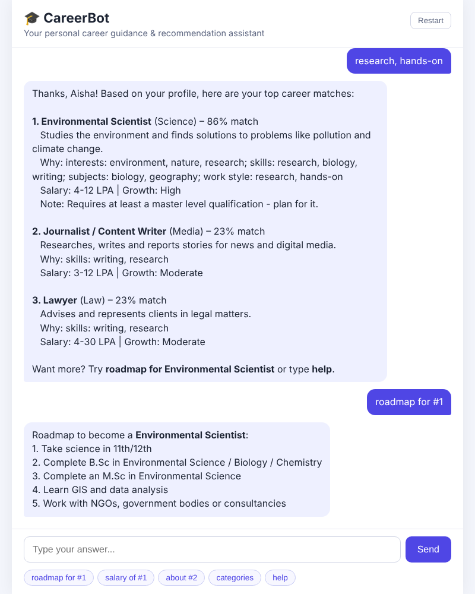

# Career Guidance and Recommendation Bot

A chatbot that asks a student a few questions about their education, interests,
skills, favourite subjects and work style, then recommends the best-matching
careers with a match percentage, the reasons for the match, salary range,
growth outlook, a step-by-step roadmap and learning resources.



## Features

- Conversational questionnaire (web chat UI and terminal mode)
- Recommendation engine with weighted matching across skills, interests,
  subjects and work style, plus synonym handling (`coding` → `programming`,
  `maths` → `mathematics`, `AI` → `artificial intelligence`, ...)
- Education-level awareness (notes when a career needs a higher qualification)
- 25 careers across Technology, Healthcare, Design, Finance, Business, Law,
  Government, Engineering, Media, Education, Science, Sports and Hospitality
- Follow-up questions: `roadmap for #1`, `salary of lawyer`,
  `about data scientist`, `resources for nurse`, `categories`,
  `careers in technology`, `restart`, `help`
- JSON API for integrating with other apps

## Project structure

```
app.py                     Flask web server + REST API
cli.py                     Terminal chat
careerbot/
  recommender.py           Profile parsing + scoring/recommendation engine
  chatbot.py               Conversation flow and follow-up answers
  data/careers.json        Career knowledge base (edit to add careers)
  templates/index.html     Chat UI
  static/                  CSS + JavaScript for the chat UI
tests/                     pytest test suite
```

## Setup

```bash
python -m venv venv
source venv/bin/activate        # Windows: venv\Scripts\activate
pip install -r requirements.txt
```

## Run

Web app:

```bash
python app.py
# open http://127.0.0.1:5000
```

Terminal:

```bash
python cli.py
```

Tests:

```bash
python -m pytest
```

## API

| Method | Endpoint          | Body / description |
|--------|-------------------|--------------------|
| POST   | `/api/chat`       | `{"start": true}` to begin, then `{"message": "..."}`. Conversation state is kept in the session cookie. |
| POST   | `/api/recommend`  | `{"education": "12th", "interests": "art, technology", "skills": "drawing", "subjects": "arts", "work_style": "creative", "top_n": 3}` |
| GET    | `/api/careers`    | Full career dataset |

## How the recommendation works

Each career has lists of `skills`, `interests`, `subjects` and `work_style`.
For every dimension the bot counts how many of the career's attributes the
user matched (matching 3 counts as full coverage) and combines them with
weights: interests 35%, skills 35%, subjects 15%, work style 15%. Careers that
need a higher qualification than the user currently has get a small penalty
and a note. The top 3 scores are shown.

## Adding a career

Add an object to `careerbot/data/careers.json` with the same fields as the
existing entries (`id`, `title`, `category`, `description`, `skills`,
`interests`, `subjects`, `work_style`, `min_education`, `avg_salary_inr`,
`growth`, `roadmap`, `resources`). `min_education` must be one of
`high school`, `diploma`, `bachelor`, `master`, `phd`.
