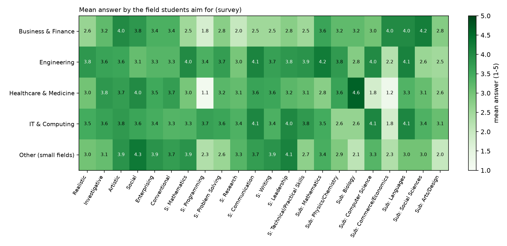

# What the survey answers show (87 responses)

Generated by `experiments/survey_insights.py` - do not edit by hand. Describes this sample only; fields with fewer than 5 students are pooled as "Other (small fields)".

## 1. Answer quality

- 4 of 87 students (4.6%) gave **all their skill ratings the same value**.
- 47.9% of all numeric skill/subject answers are 4 or 5 (students rate themselves kindly).
- Rows most often answered "Can't assess" / blank or "No experience" / "Not studied":

| row | cant_assess_or_blank_% | no_experience_or_not_studied_% |
|---|---|---|
| subject:Commerce/Economics | 0.0 | 28.7 |
| subject:Arts/Design | 0.0 | 18.4 |
| subject:Biology | 0.0 | 9.2 |
| skill:Programming | 1.1 | 8.0 |
| subject:Computer Science | 0.0 | 6.9 |
| subject:Social Sciences | 0.0 | 6.9 |

## 2. Branch (Q2) vs the field students aim for (Q8)

| branch | Agriculture & Environment | Arts, Design & Media | Business & Finance | Education | Engineering | Healthcare & Medicine | IT & Computing | Management | Not sure yet | Social Work & Psychology |
|---|---|---|---|---|---|---|---|---|---|---|
| Computer Applications (BCA) | 0 | 0 | 0 | 0 | 0 | 0 | 7 | 0 | 1 | 0 |
| Engineering (B.E. / B.Tech) | 1 | 3 | 2 | 1 | 21 | 1 | 20 | 1 | 3 | 0 |
| Medical / Nursing / Pharmacy | 0 | 0 | 0 | 0 | 0 | 20 | 0 | 0 | 0 | 0 |
| Other branches | 0 | 0 | 3 | 0 | 0 | 0 | 0 | 0 | 2 | 1 |

Students whose branch leads straight to their aimed field (Engineering->Engineering, BCA->IT, Medical->Healthcare): 48.

## 3. Mean answer by aimed field

| field | students | Realistic | Investigative | Artistic | Social | Enterprising | Conventional | skill:Mathematics | skill:Programming | skill:Problem Solving | skill:Research | skill:Communication | skill:Writing | skill:Leadership | skill:Technical/Practical Skills | subject:Mathematics | subject:Physics/Chemistry | subject:Biology | subject:Computer Science | subject:Commerce/Economics | subject:Languages | subject:Social Sciences | subject:Arts/Design |
|---|---|---|---|---|---|---|---|---|---|---|---|---|---|---|---|---|---|---|---|---|---|---|---|
| Business & Finance | 5 | 2.6 | 3.2 | 4.0 | 3.8 | 3.4 | 3.4 | 2.5 | 1.75 | 2.75 | 2.0 | 2.5 | 2.5 | 2.75 | 2.5 | 3.6 | 3.2 | 3.2 | 3.0 | 4.0 | 4.0 | 4.2 | 2.8 |
| Engineering | 21 | 3.81 | 3.62 | 3.57 | 3.14 | 3.29 | 3.29 | 4.0 | 3.38 | 3.71 | 2.95 | 4.1 | 3.67 | 3.81 | 3.86 | 4.24 | 3.76 | 2.81 | 4.0 | 2.24 | 4.14 | 2.57 | 2.48 |
| Healthcare & Medicine | 21 | 3.0 | 3.81 | 3.71 | 4.0 | 3.52 | 3.71 | 2.95 | 1.14 | 3.25 | 3.15 | 3.62 | 3.57 | 3.24 | 3.14 | 2.76 | 3.62 | 4.62 | 1.81 | 1.24 | 3.33 | 3.14 | 2.62 |
| IT & Computing | 27 | 3.48 | 3.63 | 3.78 | 3.59 | 3.44 | 3.3 | 3.33 | 3.67 | 3.59 | 3.37 | 4.07 | 3.38 | 4.04 | 3.78 | 3.48 | 2.63 | 2.63 | 4.07 | 1.81 | 4.07 | 3.37 | 3.11 |
| Other (small fields) | 7 | 3.0 | 3.14 | 3.86 | 4.29 | 3.86 | 3.71 | 3.86 | 2.29 | 2.57 | 3.29 | 3.71 | 3.86 | 4.14 | 2.71 | 3.43 | 2.86 | 2.14 | 3.29 | 2.29 | 3.0 | 3.0 | 2.0 |

Rows that differ MOST between fields (eta squared):

| row | eta_squared |
|---|---|
| skill:Programming | 0.52 |
| subject:Computer Science | 0.413 |
| subject:Biology | 0.277 |
| subject:Physics/Chemistry | 0.17 |
| subject:Mathematics | 0.151 |
| subject:Commerce/Economics | 0.145 |
| skill:Technical/Practical Skills | 0.138 |
| skill:Leadership | 0.135 |

Rows that differ LEAST:

| row | eta_squared |
|---|---|
| subject:Arts/Design | 0.035 |
| Investigative | 0.035 |
| Conventional | 0.028 |
| Enterprising | 0.016 |
| Artistic | 0.012 |

## 4. Engine Hit@5 for flat vs varied skill answers

| method | flat | students | hit_at_5 |
|---|---|---|---|
| v2 | varied skill ratings | 78 | 0.321 |
| v2 | all skills rated the same | 3 | 0.333 |
| v3 | varied skill ratings | 78 | 0.359 |
| v3 | all skills rated the same | 3 | 0.333 |

Limits: one college, small groups, self-ratings; eta squared describes this sample and is not a test.
