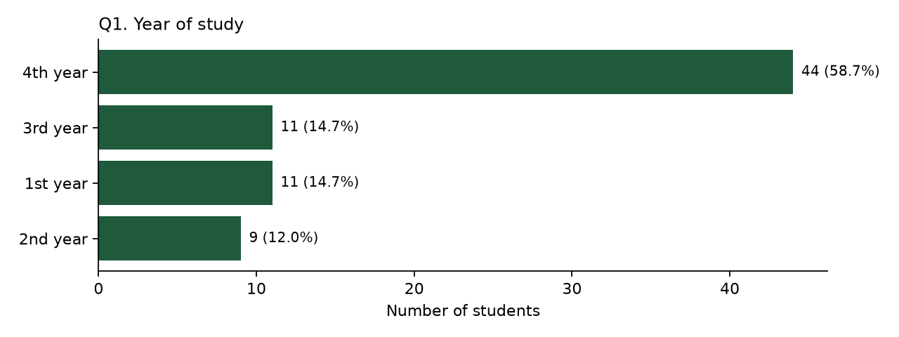
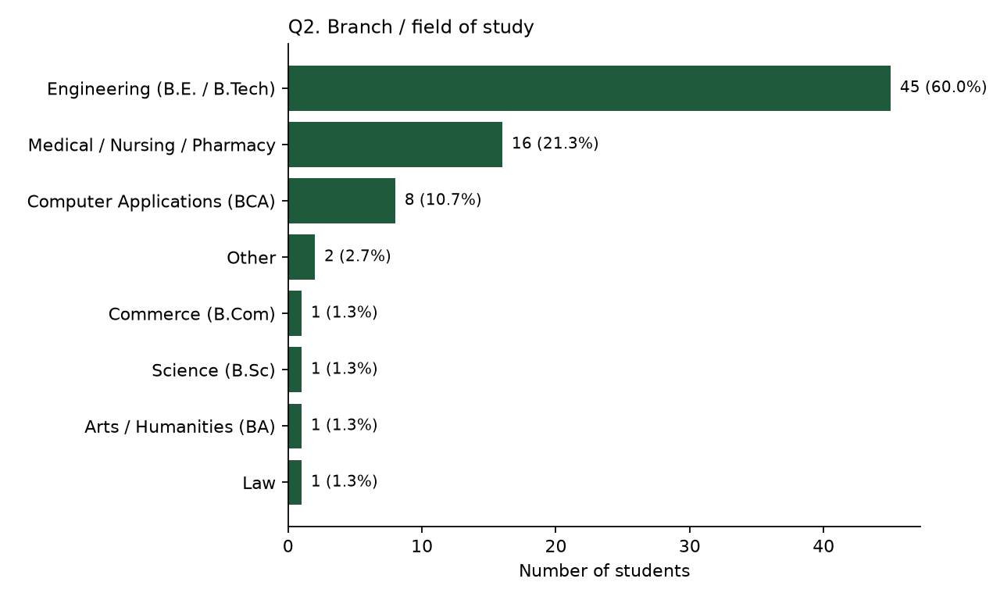
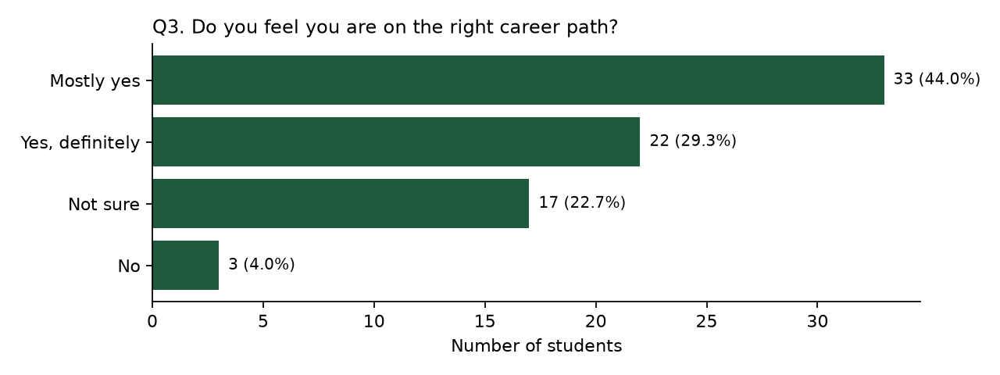
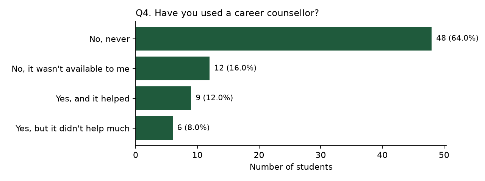
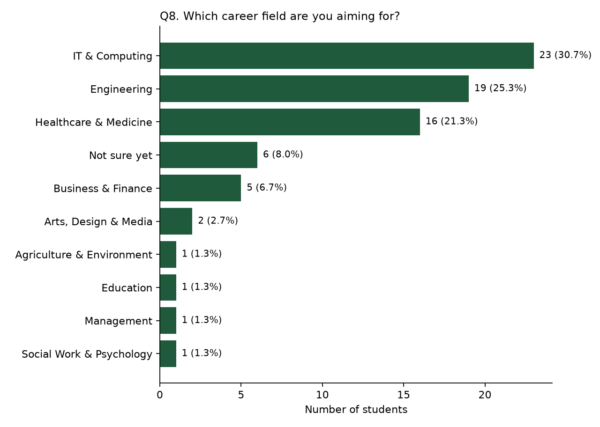
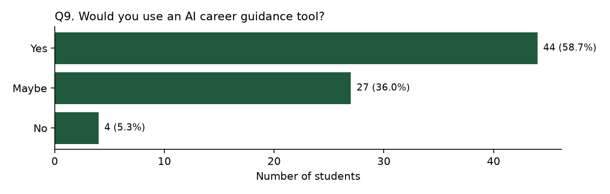

# Survey results (75 responses)

Source: `responses.csv` (Google Form from `tools/create_career_survey.gs`). Anonymous; counts only. Generated by `experiments/survey_analysis.py` - do not edit by hand.

## Key numbers

- 20 of 75 (26.7%) are not sure or do not feel they are on the right career path (Q3).
- 66 of 75 (88.0%) never used a counsellor, had none available, or were not helped (Q4).
- 6 of 75 have not chosen a career field yet (Q8).
- 44 of 75 would use an AI career guidance tool; 27 maybe (Q9).

## Q1. Year of study

| Answer | Count | % |
|---|---|---|
| 4th year | 44 | 58.7 |
| 3rd year | 11 | 14.7 |
| 1st year | 11 | 14.7 |
| 2nd year | 9 | 12.0 |

## Q2. Branch / field of study

| Answer | Count | % |
|---|---|---|
| Engineering (B.E. / B.Tech) | 45 | 60.0 |
| Medical / Nursing / Pharmacy | 16 | 21.3 |
| Computer Applications (BCA) | 8 | 10.7 |
| Other | 2 | 2.7 |
| Commerce (B.Com) | 1 | 1.3 |
| Science (B.Sc) | 1 | 1.3 |
| Arts / Humanities (BA) | 1 | 1.3 |
| Law | 1 | 1.3 |

## Q3. Do you feel you are on the right career path?

| Answer | Count | % |
|---|---|---|
| Mostly yes | 33 | 44.0 |
| Yes, definitely | 22 | 29.3 |
| Not sure | 17 | 22.7 |
| No | 3 | 4.0 |

## Q4. Have you used a career counsellor?

| Answer | Count | % |
|---|---|---|
| No, never | 48 | 64.0 |
| No, it wasn't available to me | 12 | 16.0 |
| Yes, and it helped | 9 | 12.0 |
| Yes, but it didn't help much | 6 | 8.0 |

## Q8. Which career field are you aiming for?

| Answer | Count | % |
|---|---|---|
| IT & Computing | 23 | 30.7 |
| Engineering | 19 | 25.3 |
| Healthcare & Medicine | 16 | 21.3 |
| Not sure yet | 6 | 8.0 |
| Business & Finance | 5 | 6.7 |
| Arts, Design & Media | 2 | 2.7 |
| Agriculture & Environment | 1 | 1.3 |
| Education | 1 | 1.3 |
| Management | 1 | 1.3 |
| Social Work & Psychology | 1 | 1.3 |

## Q9. Would you use an AI career guidance tool?

| Answer | Count | % |
|---|---|---|
| Yes | 44 | 58.7 |
| Maybe | 27 | 36.0 |
| No | 4 | 5.3 |

## Q3 by year of study

| Year | Mostly yes | No | Not sure | Yes, definitely |
|---|---|---|---|---|
| 1st year | 4 | 0 | 1 | 6 |
| 2nd year | 6 | 0 | 0 | 3 |
| 3rd year | 5 | 0 | 4 | 2 |
| 4th year | 18 | 3 | 12 | 11 |
